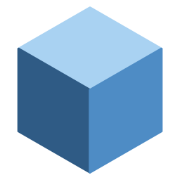
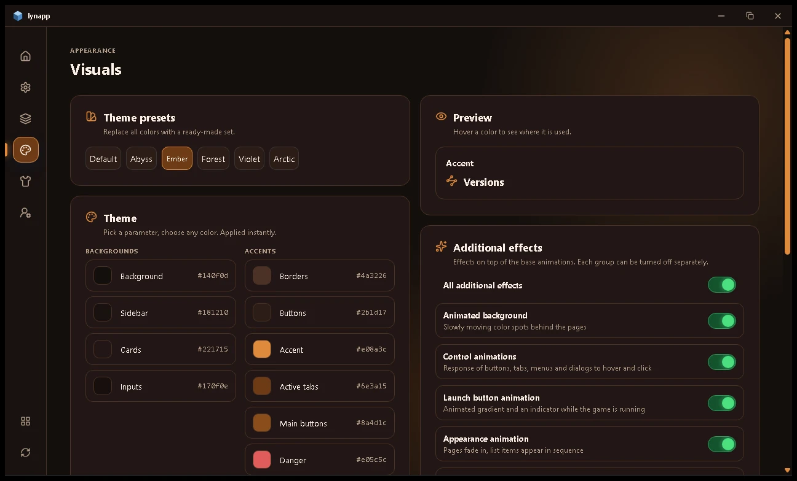

<div align="center">
  
  <h1>lynapp</h1>
  <p><strong>Fast, customizable, Windows-first Minecraft launcher built with Electron, React, and TypeScript.</strong></p>

  <p>
    <a href="https://github.com/L1ceX/lynapp/releases"></a>
    <a href="LICENSE"></a>
    
    
    
    
  </p>

  <br />
  
</div>

---

## Screenshots

<table>
  <tr>
    <td align="center">
      <br />
      <sub><b>Unified Catalog</b> (Modrinth & CurseForge)</sub>
    </td>
    <td align="center">
      <br />
      <sub><b>3D Skins & Capes</b> (Mojang & Ely.by)</sub>
    </td>
    <td align="center">
      <br />
      <sub><b>Themes & Effects</b> (13 Tokens & Presets)</sub>
    </td>
  </tr>
</table>

---

## Features

### Instances & Loaders
- **Vanilla, Fabric, Quilt, Forge, and NeoForge** with per-instance Minecraft version, loader version, RAM (`-Xmx` capped to actual system memory), and custom JVM flags.
- **Instance management:** duplicate instances, open folders, and import existing setups from **Prism Launcher**, **PolyMC**, and **MultiMC**.
- **Automatic Java provisioning:** detects the required `javaVersion.majorVersion` and downloads **Eclipse Temurin** JREs automatically (or lets you pick a local `javaw.exe`).

### Modrinth & CurseForge Integration
- **Unified content catalog** for mods, resource packs, shaders, data packs, and modpacks across **Modrinth** and **CurseForge**.
- **Project details & version picker:** inspect full descriptions and screenshots, install specific releases, and resolve required/optional dependencies automatically or via the dependency prompt.
- **Smart local file manager:** identifies existing `.jar` files via **SHA-1** (Modrinth) and **MurmurHash2** (CurseForge), checks for updates, toggles/deletes files, and detects **duplicate mods** and **mod dependents** before launch.
- **Modpack import & export:** drag-and-drop `.mrpack` (Modrinth) and CurseForge `.zip` archives into the launcher, or export your instance as `.mrpack`.

### Worlds, Servers & Screenshots
- **Worlds (`saves/`):** parses `level.dat` (NBT + gzip) to show world metadata, icons, and sizes; supports **ZIP backups** (create/restore/delete) and one-click **Quick Play** launch.
- **Servers (`servers.dat`):** live Minecraft Server List Ping (including DNS SRV resolution, MOTD, icon, version, player count, and latency) plus direct **Quick Play** join.
- **Screenshots:** grid gallery with lightbox viewer, clipboard copy, folder shortcut, and broken-image fallback.

### Accounts, Skins & Capes
- **Multiple profiles:** **Microsoft** (licensed MSA), **Ely.by** (OAuth2 / web login with automatic `authlib-injector`), and **Offline** profiles with instant switching.
- **Encrypted token storage:** account tokens are encrypted at rest via Electron `safeStorage` (**Windows DPAPI**).
- **3D Skins & Capes (`skinview3d`):** interactive 3D preview with idle pose and spring cape physics, **Mojang** skin/cape upload for Microsoft accounts, direct **Ely.by** PNG skin upload, Wide/Slim toggle, and separate per-account and shared local skin libraries.

### UI Customization & Extras
- **Modular Layout Editor:** drag and dock navigation rails/tabs to any edge, arrange Home widgets freely, and reset anytime with **`Ctrl+Shift+R`**.
- **Theming & Effects:** 13 color tokens, built-in presets (including dark and light *Arctic* themes), cursor glow, and adjustable animation speed (`50%–200%`).
- **Diagnostics & Integrations:** live game logs with automatic crash analysis (missing mod detection + *Find in catalog* shortcut + crash-report copy), **Discord Rich Presence**, system tray minimize-on-launch, bilingual **EN / RU** UI, and built-in GitHub auto-updates (`electron-updater`).

---

## Data Layout (`%APPDATA%\lynapp`)

| Path | Contents |
| :--- | :--- |
| `instances/` | Per-instance game directories, configs, mods, saves, and `.launcher/` metadata/backups |
| `minecraft/` | Shared versions, libraries, assets, and extracted natives |
| `runtimes/` | Auto-provisioned Eclipse Temurin Java runtimes |
| `skins/` | Saved local skin PNGs and library index |
| `cache/` | Cached API responses and hashes |
| `launcher-data.json` | Settings, instance registry, and DPAPI-encrypted account tokens |

---

## Project Structure

```text
src/
├── main/        # Electron main process, IPC handlers, store, updater, tray, and services
├── preload/     # Context-isolated preload bridge (window.launcher)
├── renderer/    # React 19 UI, hooks, boards, pages, modals, and styles
└── shared/      # Shared TypeScript types, IPC channel contracts, and theme definitions
```

---

## Development & Building

```powershell
npm install
npm run dev            # Start Electron + Vite with hot reload
npm run build          # Typecheck (tsc --noEmit) + production bundle
npm run dist           # Build NSIS installer + portable exe into release/
npm run dist:setup     # Build NSIS installer only
npm run dist:portable  # Build portable executable only
```

> **Optional `.env`:** set `MAIN_VITE_CURSEFORGE_API_KEY` in `.env` (escaping `$` as `\$` for `dotenv-expand`) to enable CurseForge API requests in local builds.

---

## Notes

- **Microsoft OAuth:** uses the bundled desktop OAuth client ID in `src/main/config.ts`.
- **Offline profiles:** offline skins cannot be displayed to other players by the client alone; on `online-mode=false` servers, server-side skin plugins (such as SkinsRestorer) can handle them. `online-mode=true` servers reject offline sessions.
- **Security:** never commit `%APPDATA%\lynapp\launcher-data.json` or `.env`.
