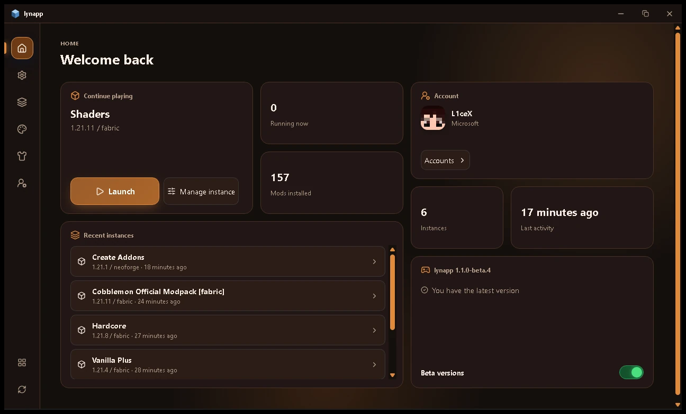
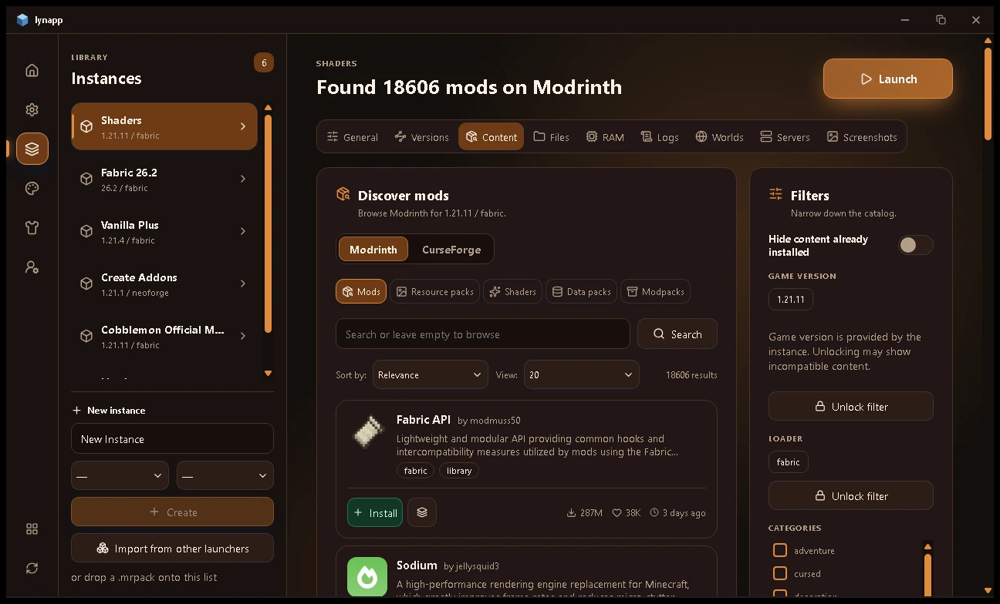
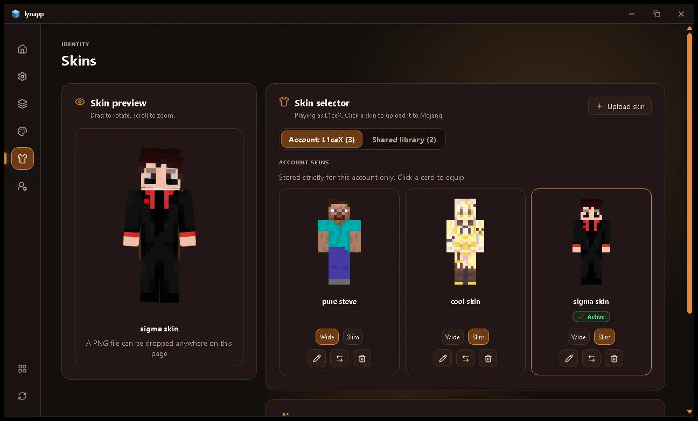

<div align="center">
  
  <h1>lynapp</h1>
  <p><strong>Fast, lightweight, customizable Minecraft launcher built with Rust, Tauri 2, React, and TypeScript.</strong></p>

  <p>
    <a href="https://github.com/L1ceX/lynapp/releases"></a>
    <a href="LICENSE"></a>
    
    
    
    
  </p>

  <br />
  
</div>

---

## Editions in This Repository

| Edition | Branch | Tags | Stack | Windows Installer |
| :--- | :--- | :--- | :--- | :--- |
| **lynapp 2.0 (Priority)** | [`main`](https://github.com/L1ceX/lynapp/tree/main) | `v2.*` | Rust + Tauri 2 + React 19 | **~5.5 MB** |
| **lynapp 1.x (Classic)** | [`v1-electron`](https://github.com/L1ceX/lynapp/tree/v1-electron) | `v1.*` | Electron 43 + React 19 | ~95 MB |

Both editions share the same `%APPDATA%\lynapp` (Windows) / `~/.config/lynapp` (Linux) data directory, so upgrading from `1.x` to `2.0` preserves instances, worlds, mods, skins, settings, and encrypted account tokens seamlessly.

---

## Screenshots

<table>
  <tr>
    <td align="center">
      <br />
      <sub><b>Unified Catalog</b> (Modrinth & CurseForge)</sub>
    </td>
    <td align="center">
      <br />
      <sub><b>3D Skins & Capes</b> (Mojang & Ely.by)</sub>
    </td>
    <td align="center">
      <br />
      <sub><b>Themes, Fonts & Liquid Glass</b></sub>
    </td>
  </tr>
</table>

---

## Features

### Lightweight Native Backend (Rust + Tauri 2)
- **~5.5 MB Windows installer** and ~30 MB idle RAM footprint, tuned for low-end PCs.
- **Seamless upgrade from Electron `1.x`:** migrates settings and Windows DPAPI tokens automatically without touching `%APPDATA%\lynapp`.
- **Cross-platform:** Windows (`x64` NSIS + portable) and Linux (`AppImage`, `.deb`, `.rpm`).

### Instances & Loaders
- **Vanilla, Fabric, Quilt, Forge, and NeoForge** with per-instance Minecraft version, loader version, RAM (`-Xmx` capped to system memory), and custom JVM flags.
- **Instance management:** clean folder names synced on rename, duplicate instances, instant search, inline Play/Stop, and import from **Modrinth App**, **Prism Launcher**, **PolyMC**, **MultiMC**, **CurseForge**, **Official / TLauncher**, and **Legacy Launcher**.
- **Automatic Java provisioning:** detects required `javaVersion.majorVersion` and downloads **Eclipse Temurin** JREs automatically.

### Modrinth & CurseForge Integration
- **Unified content catalog** for mods, resource packs, shaders, data packs, and modpacks across **Modrinth** and **CurseForge**.
- **Project details & version picker:** inspect descriptions and screenshots, install specific releases, and resolve required/optional dependencies automatically.
- **Smart local file manager:** identifies existing `.jar` files via **SHA-1** (Modrinth) and **MurmurHash2** (CurseForge), checks for updates, filters (`All / Enabled / Disabled / Updates`), and detects **duplicate mods** and **mod dependents** before launch.
- **Modpack import & export:** drag-and-drop `.mrpack` and CurseForge `.zip` archives, or export instances as `.mrpack`.

### Worlds, Servers & Screenshots
- **Worlds (`saves/`):** parses `level.dat` (NBT + gzip), manages ZIP backups, and supports one-click **Quick Play**.
- **Servers (`servers.dat`):** live Minecraft Server List Ping (DNS SRV, MOTD, icon, version, player count, latency) plus direct **Quick Play** join.
- **Screenshots:** gallery with lightbox viewer, clipboard copy, folder shortcut, and delete.

### Accounts, Skins & Capes
- **Multiple profiles:** **Microsoft** (MSA), **Ely.by** (with automatic `authlib-injector`), and **Offline** profiles with encrypted Windows DPAPI token storage.
- **3D Skins & Capes (`skinview3d`):** interactive 3D preview with spring cape physics, Mojang skin/cape management, Wide/Slim toggle, and per-account / shared skin libraries.

### UI Customization, Fonts & Liquid Glass
- **Translucent Liquid Glass UI:** GPU-light translucent glass panels, 135° specular rims, auto-hiding hover drawers with pin toggle, and dark/light (*Arctic*) calibration.
- **Modular Layout Editor:** drag and dock navigation rails/tabs to any edge, 8-direction widget resizing, **Canva-style smart alignment guides and magnetic snapping** (hold `Shift` for free sizing), and emergency reset via **`Ctrl+Shift+R`**.
- **2,100+ Font Browser & Custom Fonts:** all installed PC system fonts, full 1,960+ **Google Fonts** catalog (with style and Cyrillic filters), built-in pixel **Minecraft** font (RU/EN) and **Onest**, plus custom `.ttf` / `.otf` / `.woff` / `.woff2` upload into `%APPDATA%\lynapp\fonts\`.
- **Theming, Motion & Extras:** 13 color tokens, built-in presets, cursor glow, animation speed (`25%–200%`), live logs with crash analyzer, **Discord Rich Presence**, bilingual **EN / RU** UI, and built-in GitHub updater.

---

## Project Structure

```text
src/
├── renderer/    # React 19 UI, hooks, boards, pages, modals, fonts, and Liquid Glass styles
└── shared/      # Shared TypeScript types, IPC contracts, and theme definitions
src-tauri/
├── src/         # Rust Tauri 2 backend, 17 services, 78 IPC commands, DPAPI crypto, updater
├── icons/       # App icons
└── nsis-hooks.nsh
```

---

## Development & Building

```powershell
npm install
npm run tauri:dev      # Start Vite + Tauri 2 with hot reload
npm run build          # Typecheck (tsc --noEmit) + frontend production bundle
npx tauri build        # Build native release executable and installer
```

> **Optional `.env`:** set `CURSEFORGE_API_KEY` (or `MAIN_VITE_CURSEFORGE_API_KEY`) in `.env` to enable CurseForge API requests in local builds.

---

## Security

Never commit `%APPDATA%\lynapp\launcher-data.json` or `.env`.
